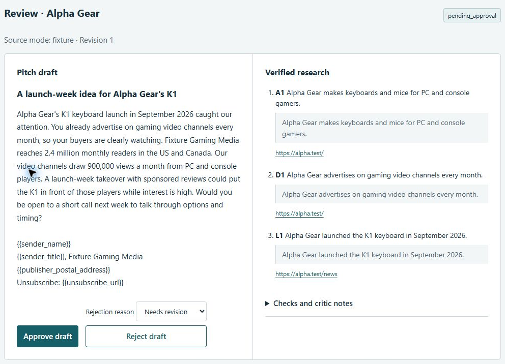
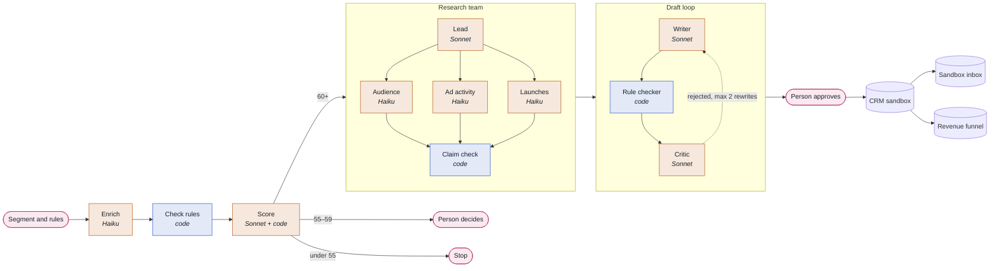

# AdScout


**Which brands should a publisher's sales team call first, and what should they say?**

AdScout researches brands that could buy ads from a gaming and tech publisher. It ranks them,
writes a cited research brief for the best ones, and drafts a first pitch. A person approves
every pitch.

- **Start here:** [six-slide deck](docs/adscout-deck.pdf)
- **Watch:** [2-minute walkthrough](docs/adscout-walkthrough.mp4) (captions, no sound needed)



| | |
| --- | --- |
| **Who uses it** | A sales or partnerships rep at a digital publisher |
| **What goes in** | A market segment, e.g. gaming hardware brands in North America, and the rules for a good customer |
| **What comes out** | A scored list, a cited brief for each strong fit, and a draft pitch waiting for approval |

## Try it (no account or API key)

Needs Git and [uv](https://docs.astral.sh/uv/getting-started/installation/).

```bash
git clone https://github.com/prentopoulos/adscout.git
cd adscout
uv run --locked adscout demo
```

Open **http://127.0.0.1:8765**, then:

1. Open **Alpha Gear**: read the draft and its source quotes.
2. **Approve draft**, then **Sync approved to local CRM**.
3. **Place in sandbox** and check the message's unsubscribe link.
4. **Simulate $2,500 won** and watch the revenue view update.

Demo companies are synthetic and model replies are scripted. **No email is sent.** Revenue is
simulated.

## How one run works



Orange: AI model call. Blue: plain code. Pink: a person.

1. **Enrich.** Read each brand's own site, Wikidata and SEC filings. Code validates every field.
2. **Check rules.** Drop brands that miss size, region or category.
3. **Score.** A model rates four criteria from 1 to 5. Code turns them into a score out of 100.
4. **Research.** A lead agent splits the work among three workers. Code keeps a claim only if
   its quote is on a page fetched in this run.
5. **Draft.** A writer drafts from checked facts only. A rule checker and a critic review it.
6. **Approve.** A person approves or rejects. Only then does code write to the CRM sandbox.

## For technical readers

**Four agent patterns, each where it fits**

| Step | Pattern | Why |
| --- | --- | --- |
| Enrich | Prompt chaining | Fixed steps in a fixed order |
| Score | Routing | The score decides where each brand goes next |
| Research | Orchestrator–workers | The path depends on what the agents find |
| Draft | Evaluator–optimizer | One model writes, another reviews |

**Stack choices**

| Part | Choice |
| --- | --- |
| Orchestration | LangGraph, for the flow only |
| Model access | Own adapter on the Anthropic SDK: fake, replay and live modes |
| Models | Haiku workers, Sonnet lead: cheapest tier that meets the bar |
| Fit score | 1–5 ratings, code does the maths, so every score is explainable |
| Database | SQLite; SQL views feed the dashboard |
| Review UI | Local web page on 127.0.0.1 |
| Evaluation | pytest cases with JSON Schema, offline on every change |
| Tracing | Local spans and cost table |
| Diagrams | C4 as code; the build fails if they drift |

**Guardrails, enforced in code and tests**

- **Read-only agents.** Research agents can search and read. They have no send, CRM or file tools.
- **Web pages are data.** Page text is never followed as an instruction. Ten planted attack
  pages, each with a clean twin, test this.
- **Every claim cited.** A pitch can only use facts that passed the claim check.
- **Approval is exact.** It covers the subject and body; any later edit blocks sending.
- **One way to write.** One CRM writer and one send function, every write logged.
- **Spend caps.** Each paid call reserves its cost first. Past the run's cap, the run stops.
  Per company, research is capped at 20 calls, 9 searches, 6 pages and $0.30 on Haiku.
- **No real personal data.** Contact data is synthetic. Only one adapter reads the API key.

**Cost and tracing.** Every model and source call records tokens, search fees, cost from a
dated price table and a trace ID. Replays of recorded calls cost $0.

```bash
uv run --locked adscout runs   --db data/demo.db           # list runs
uv run --locked adscout funnel RUN_ID --db data/demo.db    # counts per step and exit reasons
uv run --locked adscout trace  RUN_ID --db data/demo.db    # each lead's calls, tokens, cost, time
uv run --locked adscout check  RUN_ID --db data/demo.db    # re-validate a run independently
```

More: [agent flow](docs/architecture/agent-flow.html) ·
[agent registry](docs/architecture/agents.md) · [C4 model](docs/architecture/workspace.dsl) ·
[data model](docs/architecture/erd.md) · [operations](AI_OPS.md)

## Testing

| 518 tests | 90 evaluation cases | 94.8% coverage | 12-check quality gate |
| :---: | :---: | :---: | :---: |

| Evaluation cases | Count |
| --- | ---: |
| Profile rules: size, region, category | 31 |
| Claim check against source pages | 21 |
| Draft rules: every fact supported | 30 |
| Planted injection pages, with clean twins | 10 |

```bash
uv run --locked python scripts/gate.py
```

The gate runs formatting, strict types, tests with the network blocked, coverage, a secrets
scan, link checks, specs and the evaluation cases. Gate run of 19 October 2026.

All of this is offline, on synthetic companies and scripted model replies. It proves the logic
and the safety rules, **not live model quality**.

## Next

1. Live run on 5 real brands, then 30, under a $45 spending cap.
2. Label 30 brands by hand; measure precision in the top 10 and cost per qualified lead.
3. Compare Haiku with Sonnet, and the agent team with a single agent.
4. HubSpot test account, Langfuse tracing and hosted CI.

## Project layout

```text
src/adscout/   Pipeline, agents, scoring, research, drafts, CRM sandbox, review UI, CLI
config/        Segments, seed lists, schemas, model prices, demo fixtures
evals/         Offline evaluation cases
tests/         Unit and end-to-end tests, no network
openspec/      Specs and each phase's proposal, design decisions and tasks
docs/          Deck, video, screenshots, architecture diagrams
```

Built phase by phase with [OpenSpec](https://github.com/Fission-AI/OpenSpec).

## Licence

[MIT](LICENSE). Dependencies keep their own licences (see the lockfile). The vendored grilling
skill is MIT-licensed by its author ([licence](.agents/skills/grilling/LICENSE)).
A portfolio project, not affiliated with any company named in its inputs.
