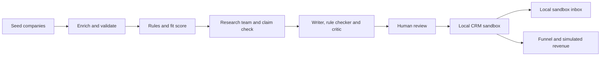

# AdScout


**Which brands fit a publisher's audience, and what should the first pitch to each one say?**

AdScout is an advertiser research and pitch review tool for a gaming and tech publisher. It
takes a market segment, such as gaming hardware brands in North America, and for each brand it
gathers company facts, scores how well the brand fits the publisher's audience, researches it
with a small team of AI agents, and drafts a first pitch backed by source quotes. A person
approves or rejects every draft. Approved prospects flow into a local CRM sandbox, a sandbox
inbox and a funnel dashboard with simulated revenue.

- **Start here:** [the six-slide deck](docs/adscout-deck.pdf) explains what the project is, why
  it matters and how it works.
- **Watch:** [the walkthrough video](docs/adscout-walkthrough.mp4) (2:00, with captions).
- **Read:** [the architecture](docs/architecture/agents.md) and
  [operations and evaluation notes](AI_OPS.md).

The research and pitch steps are AI-powered: Claude agents research each brand and draft the
pitch, and a separate check matches every claim to a quote from its source page.


*The review screen on the demo: the pitch draft on the left, the source quote behind each claim
on the right, and the approval controls. Synthetic company, fixture publisher.*

## What you get

- A **ranked list of prospects** with a fit score and the reasons behind it, including the
  brands that dropped out and why (missing data, poor fit, failed research).
- **Cited research** for each brand: every claim links to a source URL and a matching quote.
- A **pitch draft** written by one agent, checked by a rule checker and reviewed by a critic
  agent, with any unresolved concerns shown before approval.
- **Human approval** tied to the exact subject and body reviewed. Editing either one needs a
  new approval.
- A **local CRM sandbox** and **sandbox inbox** with a working unsubscribe link, plus a
  **funnel dashboard** that connects approved prospects to simulated deals.
- **Cost and trace records** for every model and source call, and a spend cap checked in code
  before any paid call.

It is **not** an email sender, a real CRM integration or evidence of sales results. The demo
uses synthetic companies and scripted model responses. **No email is sent**, and revenue is
simulated.

| Term | Plain meaning |
| --- | --- |
| Segment | The market being prospected, with rules for which companies qualify. |
| Fit score | A 0–100 score from the segment rules and a rated rubric, with the reasons kept. |
| Research team | A lead agent and three read-only worker agents that search and read company pages. |
| Claim check | Code that confirms each research claim appears, quoted, on its source page. |
| Critic | A second agent that reviews the pitch draft and flags concerns for the reviewer. |
| Sandbox | A local SQLite stand-in for a CRM or inbox. Nothing leaves your machine. |
| Simulated revenue | A demo deal value entered by the user, not a measured sales result. |

## Try it — no account or key needed

You need **Git** and **[uv](https://docs.astral.sh/uv/getting-started/installation/)**. uv
installs Python 3.13 and the locked packages on first use, so the first run needs internet
access. The demo then runs offline.

```bash
git clone https://github.com/prentopoulos/adscout.git
cd adscout
uv run --locked adscout demo
```

Open **http://127.0.0.1:8765**. Stop it with Ctrl+C. The first run creates `data/demo.db`;
later runs reuse it and keep your decisions. Use `--db data/another-demo.db` for a fresh demo.

1. Select **Alpha Gear** and read its draft beside its source quotes.
2. Click **Approve draft**, then **Sync approved to local CRM**.
3. Click **Place in sandbox** and open the local message and its unsubscribe link.
4. Click **Simulate $2,500 won** to see the revenue view update.
5. Open **Hotel Gear**, whose critic concerns are still unresolved, and approve or reject it.

The demo runs the real pipeline code for validation, scoring, claim checks and draft rules.
Only the model responses and company pages are scripted, so demo scores say nothing about live
model quality.

## Inspect a run

```bash
uv run --locked adscout runs --db data/demo.db
uv run --locked adscout funnel RUN_ID --db data/demo.db
uv run --locked adscout trace RUN_ID --db data/demo.db --lead alpha.test
uv run --locked adscout export RUN_ID --db data/demo.db
uv run --locked adscout check RUN_ID --db data/demo.db
```

`runs` lists pipeline runs, `funnel` shows how many prospects reached each stage, `trace` shows
every step, call and cost for one company, `export` writes the run's records, and `check`
re-verifies a run's stored results.

## How it works



1. **Enrich and validate.** Each seed company gets its public facts, and code rejects missing
   or malformed fields instead of guessing.
2. **Score.** Fixed rules screen out companies outside the segment. A model rates the rest
   against a rubric, and code does the arithmetic for the final fit score.
3. **Research.** A lead agent splits the work across three read-only workers that search and
   read company pages. Every claim they return must carry a URL and a quote, and code checks
   the quote is really on the page.
4. **Draft.** A writer agent drafts the pitch from verified research and the publisher's media
   kit. A rule checker enforces the required content, and a critic agent reviews the draft.
5. **Review and follow-through.** A person approves or rejects each draft. Approved prospects
   sync to the CRM sandbox, can be placed in the sandbox inbox, and feed the funnel dashboard.

The agent workflow runs on LangGraph with Claude models through the Anthropic API. Agents only
get read-only tools, with limits on steps, pages and workers enforced in code. Every model and
source call records its tokens, cost and trace ID, and a run reserves budget before a paid call.
Company pages are fetched politely: the fetcher follows `robots.txt` and treats page text as
data, never as instructions.

More detail:
- [Agent flow](docs/architecture/agent-flow.html) and [agent registry](docs/architecture/agents.md)
- [C4 architecture model](docs/architecture/workspace.dsl) and [data model](docs/architecture/erd.md)
- [Operations, evaluation and recovery](AI_OPS.md)

## Limits

- **Data:** demo companies are synthetic and the publisher is a fixture. Personal contact data
  is never real.
- **Quality:** the offline evaluation suite tests rules, claim checks, draft rules and
  prompt-injection pages with scripted responses. A labelled 30-company study of live model
  quality and cost per qualified lead has not been run yet.
- **Delivery:** the CRM and inbox are local sandboxes. A sandbox message is not proof of email
  deliverability.
- **Scope:** single user, local only. The server listens on 127.0.0.1.

Next: run the labelled live study (qualification precision, citation accuracy, cost per
qualified lead and minutes per account), then connect a hosted CRM sandbox and package the app.

## Project layout

```text
src/adscout/     Pipeline, agents, scoring, research, drafts, CRM sandbox, workspace UI and CLI
config/          Segments, seed lists, schemas, model prices and demo fixtures
evals/           Offline evaluation cases
tests/           Unit and end-to-end tests; no network
openspec/        Requirements, and each phase's proposal, design decisions and tasks
docs/            Deck, video, screenshots, architecture diagrams and walkthrough script
scripts/         The quality gate
```

## Development

```bash
uv sync --locked
uv run --locked python scripts/gate.py
```

The gate checks formatting and strict types, runs the tests with network access blocked and at
least 90% coverage, scans for secrets, checks documentation links, validates the specs and
commit messages, and runs the offline evaluation cases. Tests use fixtures, so they need no
account or key.

The project was built phase by phase with [OpenSpec](https://github.com/Fission-AI/OpenSpec):
each phase's decisions are in `openspec/changes/`.

## Licence and credits

This project's code and documentation are released under the [MIT License](LICENSE).
Python dependencies keep their own licences, recorded in the lockfile. The vendored grilling
skill is MIT-licensed by its author; see [its licence](.agents/skills/grilling/LICENSE).

AdScout is a portfolio project. It is not affiliated with or endorsed by any company or
publisher named in its inputs.
