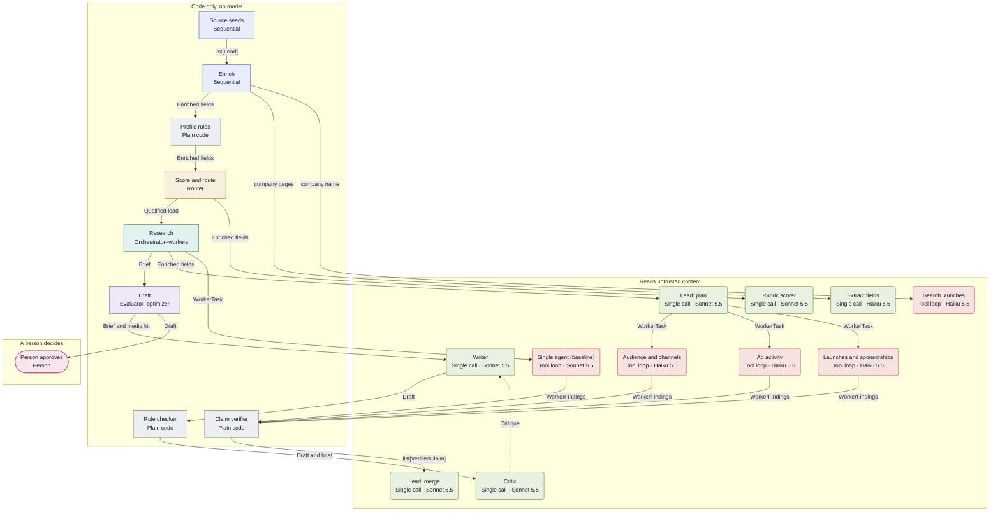
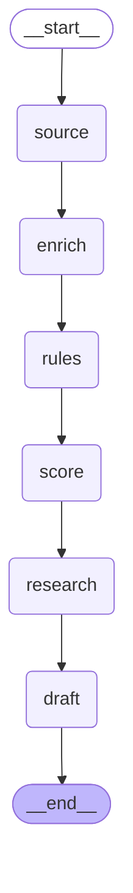

# Agent flow

Generated by `scripts/diagrams.py` from the agent registry
(`src/adscout/pipeline/registry.py`); do not edit by hand. To change it, change the
registry, then run `uv run --locked python scripts/diagrams.py write` and
`scripts/architecture.py stamp`. The gate fails when this file or `agent-flow.html`
differs from a fresh generation. [`agent-flow.html`](agent-flow.html) draws the same flow
with each node's model, tools, caps and typed handoffs.

## Registry flow

Groups are trust zones; colours are patterns; edge labels name the handoff types. The
dashed edge is the draft loop's rewrite.

| Pattern | Registry name |
|---|---|
| Sequential | `sequential` |
| Router | `router` |
| Orchestrator–workers | `orchestrator_workers` |
| Evaluator–optimizer | `evaluator_optimizer` |
| Single call | `single_call` |
| Tool loop | `tool_loop` |
| Plain code | `code` |
| Person | `human` |

| Trust zone | Registry name |
|---|---|
| Reads untrusted content | `untrusted_content` |
| Model with no tools | `no_tools` |
| Code only, no model | `code_only` |
| A person decides | `human` |

## Node limits

| Node | Model | Tools | Caps |
|---|---|---|---|
| source | Code | None | See step/run limits |
| enrich | Code | None | See step/run limits |
| extractor | Haiku 5.5 · low effort · falls back to Sonnet 5.5 | None | See step/run limits |
| launch_searcher | Haiku 5.5 · low effort · falls back to Sonnet 5.5 | submit_launches, web_search | ≤ 2 calls · 1 search |
| rules | Code | None | See step/run limits |
| score | Code | None | See step/run limits |
| scorer | Sonnet 5.5 · low effort · falls back to Haiku 5.5 | None | See step/run limits |
| research | Code | None | ≤ 20 calls · 9 searches · 6 pages · $0.30 Haiku 5.5 · $0.90 Sonnet 5.5 |
| research_plan | Sonnet 5.5 · medium effort · falls back to Haiku 5.5 | None | See step/run limits |
| worker_audience | Haiku 5.5 · low effort · falls back to Sonnet 5.5 | fetch_page, submit_findings, web_search | ≤ 6 calls · 3 searches · 2 pages · 90 s · $0.10 Haiku 5.5 · $0.40 Sonnet 5.5 |
| worker_ads | Haiku 5.5 · low effort · falls back to Sonnet 5.5 | fetch_page, submit_findings, web_search | ≤ 6 calls · 3 searches · 2 pages · 90 s · $0.10 Haiku 5.5 · $0.40 Sonnet 5.5 |
| worker_launches | Haiku 5.5 · low effort · falls back to Sonnet 5.5 | fetch_page, submit_findings, web_search | ≤ 6 calls · 3 searches · 2 pages · 90 s · $0.10 Haiku 5.5 · $0.40 Sonnet 5.5 |
| research_single | Sonnet 5.5 · medium effort · falls back to Haiku 5.5 | fetch_page, submit_findings, web_search | ≤ 12 calls · 9 searches · 6 pages · $0.30 Haiku 5.5 · $0.90 Sonnet 5.5 |
| verifier | Code | None | See step/run limits |
| research_merge | Sonnet 5.5 · medium effort · falls back to Haiku 5.5 | None | See step/run limits |
| draft | Code | None | See step/run limits |
| writer | Sonnet 5.5 · medium effort · falls back to Haiku 5.5 | None | ≤ $0.12 Haiku 5.5 · $0.12 Sonnet 5.5 |
| rule_checker | Code | None | See step/run limits |
| critic | Sonnet 5.5 · low effort · falls back to Haiku 5.5 | None | See step/run limits |
| approval | Code | None | See step/run limits |

## Compiled pipeline graph

The step chain as LangGraph compiles it from the registry's steps (`draw_mermaid()`).

