# AdScout database (entity-relationship diagram)

Generated by `scripts/erd.py` from a freshly migrated database; do not edit by hand.
Every table is STRICT. `leads` refuses updates and deletes of its source fields, and
`fake_crm_*` tables are the local stand-in for the CRM sandbox until Phase 4.

```mermaid
erDiagram
    approvals {
        TEXT approval_id PK
        TEXT run_id FK
        TEXT lead_id FK
        INTEGER draft_id FK
        TEXT draft_sha256
        TEXT decision
        TEXT approver_kind
        TEXT approver
        TEXT reason
        TEXT decided_at
        TEXT approved_subject_sha256
    }
    briefs {
        INTEGER brief_id PK
        TEXT lead_id FK
        TEXT run_id FK
        TEXT implementation
        TEXT status
        TEXT summary
        TEXT claims_json
        TEXT created_at
        TEXT design
        TEXT summary_points_json
        TEXT gaps_json
        TEXT caps_json
        INTEGER dropped_claims
        TEXT verifier_version
    }
    claims {
        INTEGER claim_id PK
        INTEGER brief_id FK
        TEXT claim_key
        TEXT agent_name
        TEXT topic
        TEXT text
        TEXT source_url
        TEXT quote
        TEXT fetch_call_id FK
        INTEGER url_fetched_in_run
        INTEGER quote_found
        INTEGER numbers_ok
        INTEGER names_individual
        INTEGER carries_link
        INTEGER verified
        TEXT drop_reason
        TEXT verifier_version
        TEXT created_at
    }
    companies {
        INTEGER company_id PK
        TEXT domain
        TEXT name
        TEXT created_run_id FK
        TEXT created_at
    }
    config_snapshots {
        TEXT content_hash PK
        TEXT kind
        TEXT segment_id
        TEXT content_json
        TEXT first_seen_at
    }
    crm_writes {
        TEXT operation_id PK
        TEXT run_id FK
        TEXT lead_id FK
        TEXT approval_id FK
        TEXT target
        TEXT domain
        TEXT operation
        TEXT fields_written_json
        TEXT fields_skipped_json
        TEXT status
        TEXT detail
        TEXT written_at
    }
    drafts {
        INTEGER draft_id PK
        TEXT lead_id FK
        TEXT run_id FK
        TEXT implementation
        INTEGER revision
        TEXT subject
        TEXT body
        TEXT body_sha256
        TEXT status
        TEXT created_at
        TEXT sentences_json
        TEXT checks_json
        TEXT critic_notes_json
        TEXT publisher_id
        INTEGER brief_id FK
    }
    enrichment_fields {
        INTEGER field_id PK
        INTEGER enrichment_id FK
        TEXT lead_id FK
        TEXT run_id FK
        TEXT field
        TEXT value_json
        TEXT source_url
        TEXT source_kind
        TEXT method
        TEXT source_call_id FK
        TEXT model_call_id FK
        TEXT retrieved_at
        TEXT as_of
        TEXT status
        TEXT status_detail
        TEXT created_at
    }
    enrichments {
        INTEGER enrichment_id PK
        TEXT lead_id FK
        TEXT run_id FK
        TEXT implementation
        TEXT fields_json
        TEXT missing_fields_json
        TEXT created_at
    }
    fake_crm_account_fields {
        INTEGER crm_account_id PK, FK
        TEXT field PK
        TEXT value
        TEXT owner
        TEXT updated_at
    }
    fake_crm_accounts {
        INTEGER crm_account_id PK
        TEXT domain
        TEXT created_by
        TEXT created_at
    }
    lead_step_outcomes {
        INTEGER outcome_id PK
        TEXT run_id FK
        TEXT step FK
        TEXT lead_id FK
        INTEGER seed_row
        TEXT outcome
        TEXT reason
        TEXT flag
        TEXT detail
        TEXT implementation
        TEXT started_at
        TEXT ended_at
    }
    leads {
        TEXT lead_id PK
        TEXT segment_id
        INTEGER company_id FK
        TEXT source
        TEXT prompt_version
        TEXT agent_version
        TEXT created_run_id FK
        TEXT created_at
    }
    model_calls {
        TEXT call_id PK
        TEXT run_id FK
        TEXT step FK
        TEXT lead_id FK
        TEXT role
        TEXT agent_name
        TEXT model
        TEXT effort
        TEXT prompt_version
        TEXT call_role
        TEXT mode
        TEXT status
        TEXT error_category
        TEXT error_detail
        TEXT request_sha256
        INTEGER input_tokens
        INTEGER cache_write_tokens
        INTEGER cache_read_tokens
        INTEGER output_tokens
        INTEGER web_search_requests
        REAL search_fee_usd
        REAL cost_usd
        REAL original_cost_usd
        REAL reserved_usd
        TEXT price_date
        INTEGER latency_ms
        TEXT stop_reason
        TEXT trace_id
        TEXT span_id
        TEXT parent_span_id
        TEXT operation
        TEXT null_reasons_json
        TEXT started_at
        TEXT ended_at
    }
    runs {
        TEXT run_id PK
        TEXT kind
        TEXT segment_id
        TEXT status
        TEXT started_at
        TEXT ended_at
        TEXT error_category
        TEXT error_detail
        TEXT validation_outcome
        TEXT validation_detail
        TEXT source
        TEXT code_revision
        INTEGER code_dirty
        TEXT lock_digest
        TEXT package_version
        TEXT agent_version
        TEXT prompt_version
        TEXT python_version
        TEXT platform
        INTEGER schema_version
        TEXT icp_config_hash FK
        TEXT seed_list_hash FK
        TEXT stub_script_hash FK
        TEXT budgets_json
        TEXT null_reasons_json
        INTEGER pid
        TEXT host
        TEXT site_list_hash FK
        TEXT media_kit_hash FK
        TEXT price_table_hash FK
        TEXT options_json
        TEXT cost_summary_json
    }
    sandbox_messages {
        TEXT message_id PK
        TEXT approval_id FK
        TEXT lead_id FK
        TEXT destination
        TEXT sender
        TEXT subject
        TEXT body
        TEXT created_at
    }
    sandbox_suppressions {
        TEXT lead_id PK, FK
        TEXT created_at
    }
    schema_migrations {
        INTEGER version PK
        TEXT name
        TEXT sha256
        TEXT applied_at
    }
    scores {
        INTEGER score_id PK
        TEXT lead_id FK
        TEXT run_id FK
        TEXT implementation
        REAL score
        TEXT reasons_json
        TEXT null_reasons_json
        TEXT created_at
        TEXT criteria_json
        INTEGER sample
        TEXT model_call_id FK
    }
    simulated_deals {
        TEXT lead_id PK, FK
        TEXT stage
        INTEGER amount_cents
        TEXT currency
        INTEGER simulated
        TEXT updated_at
    }
    source_calls {
        TEXT call_id PK
        TEXT run_id FK
        TEXT step FK
        TEXT lead_id FK
        TEXT kind
        TEXT target
        TEXT mode
        TEXT status
        TEXT robots_decision
        INTEGER http_status
        INTEGER bytes
        TEXT content_sha256
        TEXT results_json
        TEXT model_call_id FK
        TEXT detail
        REAL cost_usd
        INTEGER latency_ms
        TEXT trace_id
        TEXT span_id
        TEXT parent_span_id
        TEXT operation
        TEXT started_at
        TEXT ended_at
    }
    spans {
        TEXT span_id PK
        TEXT trace_id
        TEXT parent_span_id
        TEXT run_id FK
        TEXT lead_id FK
        TEXT step FK
        TEXT operation
        TEXT agent_name
        TEXT status
        TEXT detail
        TEXT started_at
        TEXT ended_at
    }
    step_runs {
        TEXT run_id PK, FK
        TEXT step PK
        INTEGER seq
        TEXT implementation
        TEXT implementation_version
        TEXT status
        TEXT started_at
        TEXT ended_at
        INTEGER duration_ms
        INTEGER entering
        INTEGER kept
        INTEGER exited
        TEXT model
        INTEGER input_tokens
        INTEGER output_tokens
        REAL cost_usd
        TEXT null_reasons_json
    }
    approvals }o--|| drafts : "draft_id"
    approvals }o--|| leads : "lead_id"
    approvals }o--|| runs : "run_id"
    briefs }o--|| leads : "lead_id"
    briefs }o--|| runs : "run_id"
    claims }o--|| briefs : "brief_id"
    claims }o--|| source_calls : "fetch_call_id"
    companies }o--|| runs : "created_run_id"
    crm_writes }o--|| approvals : "approval_id"
    crm_writes }o--|| leads : "lead_id"
    crm_writes }o--|| runs : "run_id"
    drafts }o--|| briefs : "brief_id"
    drafts }o--|| leads : "lead_id"
    drafts }o--|| runs : "run_id"
    enrichment_fields }o--|| enrichments : "enrichment_id"
    enrichment_fields }o--|| leads : "lead_id"
    enrichment_fields }o--|| model_calls : "model_call_id"
    enrichment_fields }o--|| runs : "run_id"
    enrichment_fields }o--|| source_calls : "source_call_id"
    enrichments }o--|| leads : "lead_id"
    enrichments }o--|| runs : "run_id"
    fake_crm_account_fields }o--|| fake_crm_accounts : "crm_account_id"
    lead_step_outcomes }o--|| leads : "lead_id"
    lead_step_outcomes }o--|| step_runs : "run_id, step"
    leads }o--|| companies : "company_id"
    leads }o--|| runs : "created_run_id"
    model_calls }o--|| leads : "lead_id"
    model_calls }o--|| runs : "run_id"
    model_calls }o--|| step_runs : "run_id, step"
    runs }o--|| config_snapshots : "icp_config_hash"
    runs }o--|| config_snapshots : "media_kit_hash"
    runs }o--|| config_snapshots : "price_table_hash"
    runs }o--|| config_snapshots : "seed_list_hash"
    runs }o--|| config_snapshots : "site_list_hash"
    runs }o--|| config_snapshots : "stub_script_hash"
    sandbox_messages }o--|| approvals : "approval_id"
    sandbox_messages }o--|| leads : "lead_id"
    sandbox_suppressions }o--|| leads : "lead_id"
    scores }o--|| leads : "lead_id"
    scores }o--|| model_calls : "model_call_id"
    scores }o--|| runs : "run_id"
    simulated_deals }o--|| leads : "lead_id"
    source_calls }o--|| leads : "lead_id"
    source_calls }o--|| model_calls : "model_call_id"
    source_calls }o--|| runs : "run_id"
    source_calls }o--|| step_runs : "run_id, step"
    spans }o--|| leads : "lead_id"
    spans }o--|| runs : "run_id"
    spans }o--|| step_runs : "run_id, step"
    step_runs }o--|| runs : "run_id"
```

